# HanziFlow: Learning App

A Flutter app that takes absolute beginners through **HSK 1 Chinese**, with honest AI feedback on pronunciation and handwriting, and AI-generated practice sentences that stay within what a beginner knows.

**[Try the live app](https://www.hanziflow.site)** · **[Full case study and demo video](https://shn047.github.io/projects/hanziflow-app.html)**

> This repository is a showcase. The source code is private while the capstone project is being assessed; a code walkthrough is available on request.

| | |
|---|---|
| **Status** | Live beta, deployed; user testing with beginners is next |
| **Team** | Team of 3 · Capstone project, KMUTT · Jan – Nov 2026 |
| **My role** | Built the Flutter app; main contributor to the pronunciation model |
| **Stack** | Flutter · Dart · FastAPI · Supabase (PostgreSQL) · AWS EC2 · Nginx · PyTorch · Wav2Vec2 · ResNet CNN · DeepSeek |

<table>
  <tr>
    <td>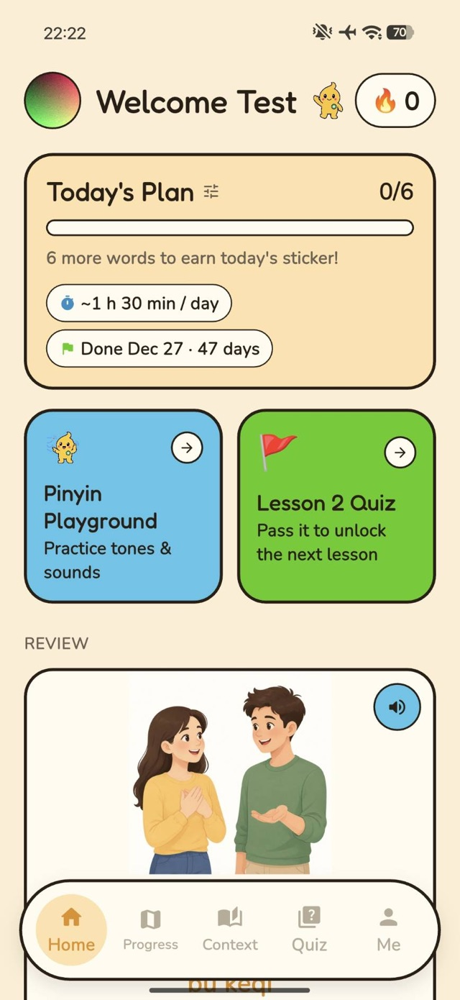</td>
    <td>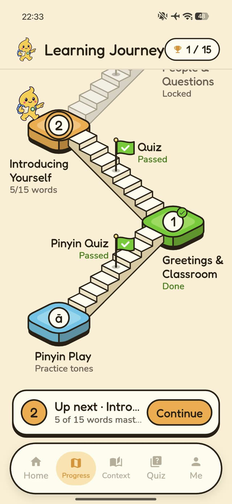</td>
    <td>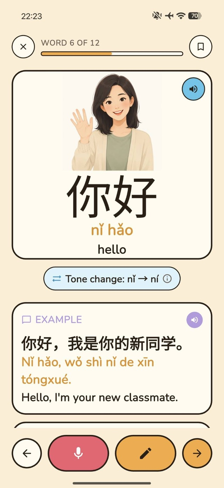</td>
    <td>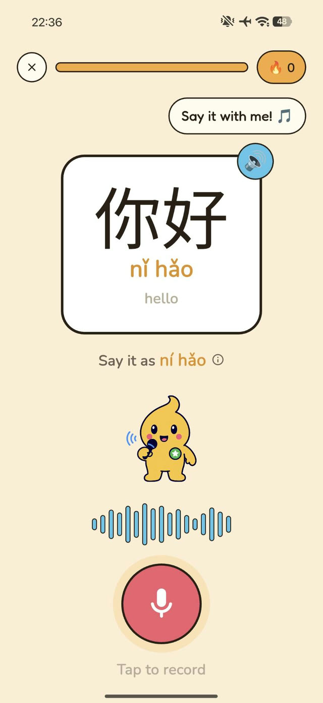</td>
  </tr>
  <tr>
    <td align="center">Home</td>
    <td align="center">Journey</td>
    <td align="center">Word card</td>
    <td align="center">Speaking</td>
  </tr>
  <tr>
    <td>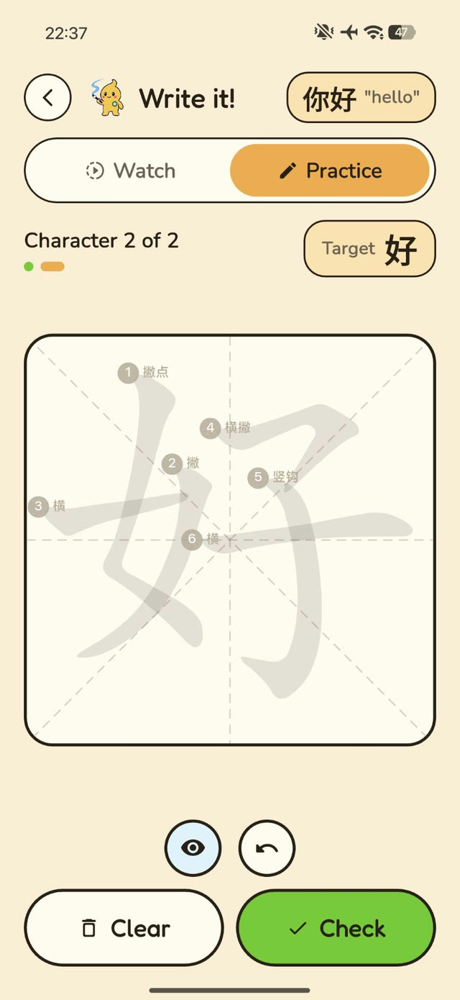</td>
    <td>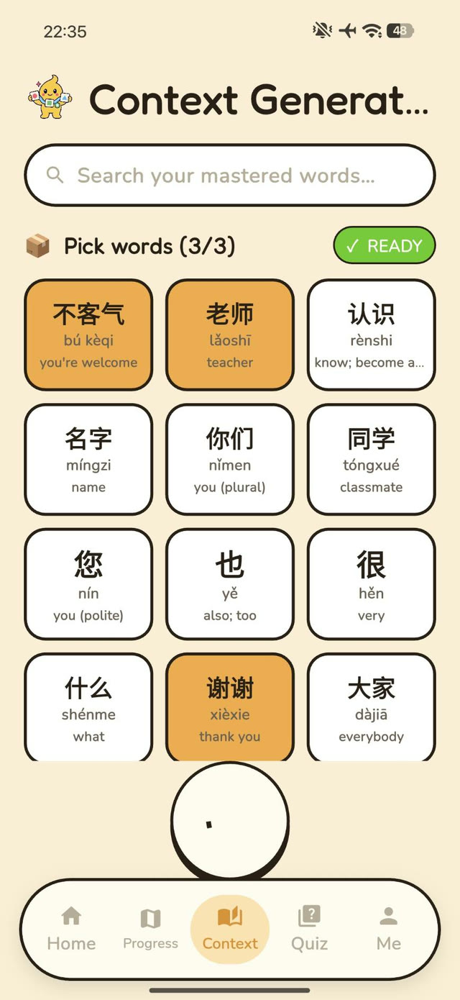</td>
    <td>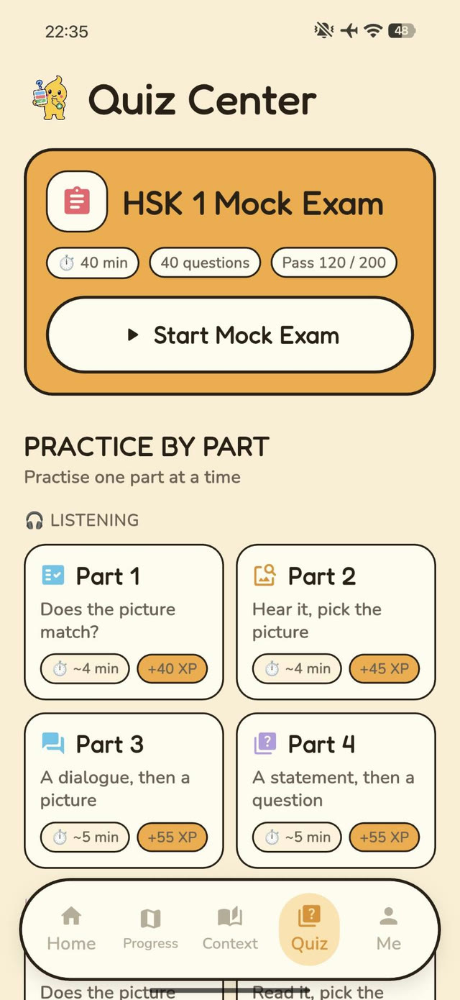</td>
    <td>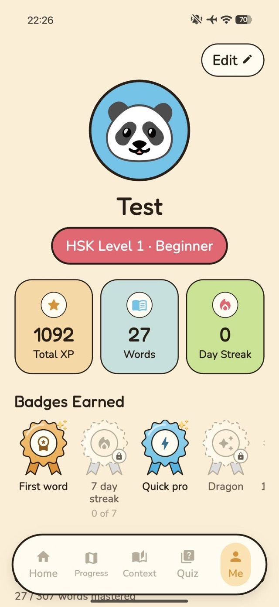</td>
  </tr>
  <tr>
    <td align="center">Writing</td>
    <td align="center">Context</td>
    <td align="center">Quizzes</td>
    <td align="center">Profile</td>
  </tr>
</table>

## The problem

Most beginner apps help learners memorise, but rarely tell them honestly when they are wrong:

- **Pronunciation:** standard speech-to-text auto-corrects to the closest real word, so a wrong tone is often accepted.
- **Writing:** learners trace characters, but few apps check whether what they wrote is right.
- **Vocabulary:** words are memorised from lists, without being used in sentences.

## My role

- **Flutter app:** I built the app for Android and web: the screens, app state, and the connection to Supabase (sign-in, database and storage) and to the AI services.
- **Pronunciation model (main contributor):** I prepared the training data and trained the base Wav2Vec2 model; a teammate continued the training. I then built the scoring logic and calibration, finalised the model and integrated it into the app.
- **UI design:** designed together as a team; I contributed to the design and implemented it in Flutter.

## Features

1. **Pinyin Playground:** combine initials and finals on a grid and compare all four tones.
2. **Word cards:** 307 HSK 1 words across 15 lessons, each with an image, native audio, an example sentence and its grammar pattern.
3. **Character writing:** stroke animation, ghost tracing, then an ML check: correct, incomplete or wrong character.
4. **Pronunciation:** per-syllable scores based on the tone actually spoken, without auto-correction.
5. **Context generation:** pick 2–3 learned words and get a short story that uses only HSK 1 vocabulary and grammar.
6. **Quizzes:** HSK 1 listening and reading practice in the official exam format, lesson checkpoints and a full mock exam.

XP, a daily streak, badges and an HSK 1 progress bar keep learners practising.

## Architecture

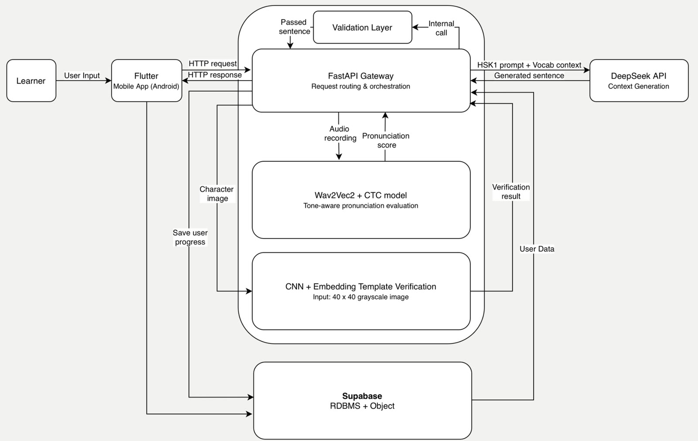

- **Flutter app** (Android APK and web): Provider state management and a repository pattern.
- **Supabase:** Google sign-in, row-level security, 36 versioned migrations, and storage for audio and illustrations.
- **FastAPI on AWS EC2** behind Nginx: one server exposes `/pronunciation/score`, `/writing/verify` and `/generate-context`.

## How the AI works

**Pronunciation.** A Wav2Vec2 (XLSR-53) model with separate CTC heads for initials, finals and tones. The target pinyin is known in advance (e.g. `ni3 hao3`), so for each syllable the system finds the frames where the target is most likely and compares it with the strongest competing token. If `hao4` beats the expected `hao3`, the learner is told so instead of the word being silently accepted. Tone-change rules are applied too: for 你好 the app tells the learner to say *ní hǎo*.

**Handwriting.** The drawing is cropped, centred and resized to 40 × 40 greyscale. A ResNet-style CNN turns it into a 512-dimension embedding, which is compared with templates for 256 HSK 1 characters using cosine similarity. A stroke checker then gives specific feedback on stroke order.

**Context generation.** DeepSeek (through OpenRouter) writes the story, but the backend trusts none of it: every word is segmented and checked against the 307-word HSK 1 list, length and grammar must fit approved patterns, and after up to 3 retries it falls back to a template.

<table>
  <tr>
    <td>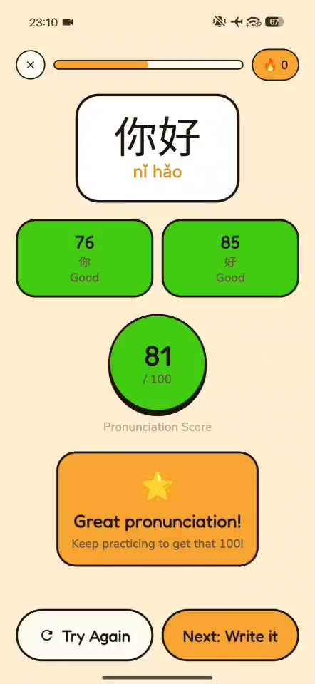</td>
    <td>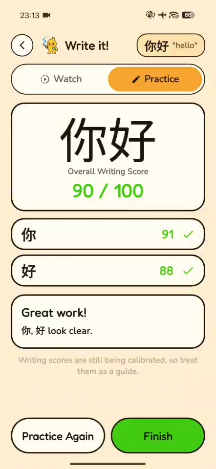</td>
  </tr>
  <tr>
    <td align="center">Per-syllable pronunciation score</td>
    <td align="center">Handwriting result</td>
  </tr>
</table>

## Evaluation

Both models are **strict by design**: for beginners, praising a mistake is worse than asking for a retry.

**Pronunciation: 100 AISHELL clips (50 correct, 50 mismatched)**

| | Rated good | Rated incorrect |
|---|---|---|
| Actually correct | 28 | 22 |
| Actually wrong | 0 | 50 |

Precision 100% (no wrong pronunciation rated good) · recall 56% · accuracy 78%.

**Handwriting: rejecting unknown input, 11,600 CASIA-HWDB samples**

| | Accepted | Rejected |
|---|---|---|
| Valid characters (10,654) | 10,483 | 171 |
| Unknown inputs (946) | 0 | 946 |

0 unknown inputs accepted · 1.6% of valid writing asked to retry. Separately, the model recognised characters with 97.55% overall accuracy.

## Next: user testing

5–10 absolute beginners will test the app. App pronunciation scores will be compared with a Chinese teacher's ratings (Pearson correlation), along with a SUS usability score.

## What I learned

- **Choose the right error to avoid.** For learners, a false "correct" costs more than an extra retry.
- **Never trust the LLM's word.** A deterministic validation layer is what makes generated content safe to show.
- **The app makes the model useful.** Recording, uploads, waiting states and clear per-syllable feedback decide whether learners trust an AI score.
